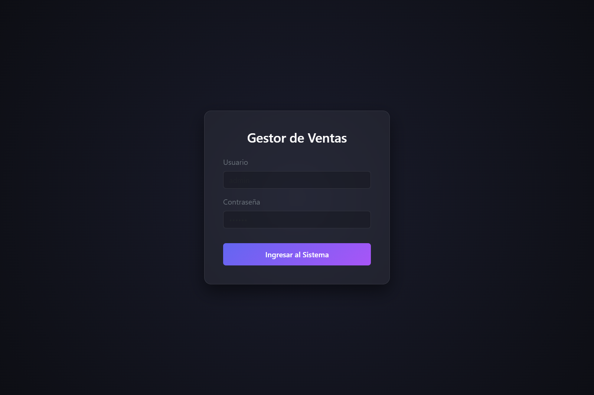
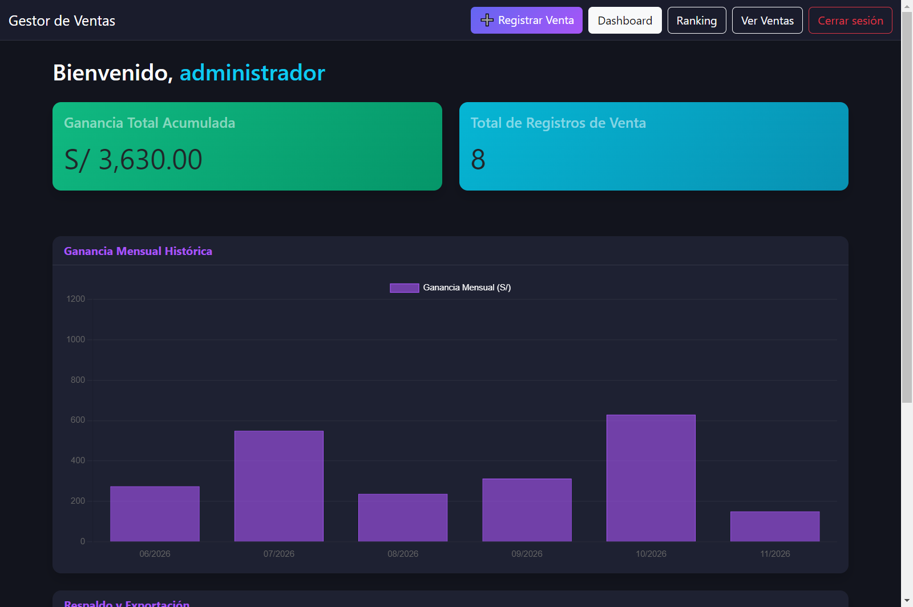
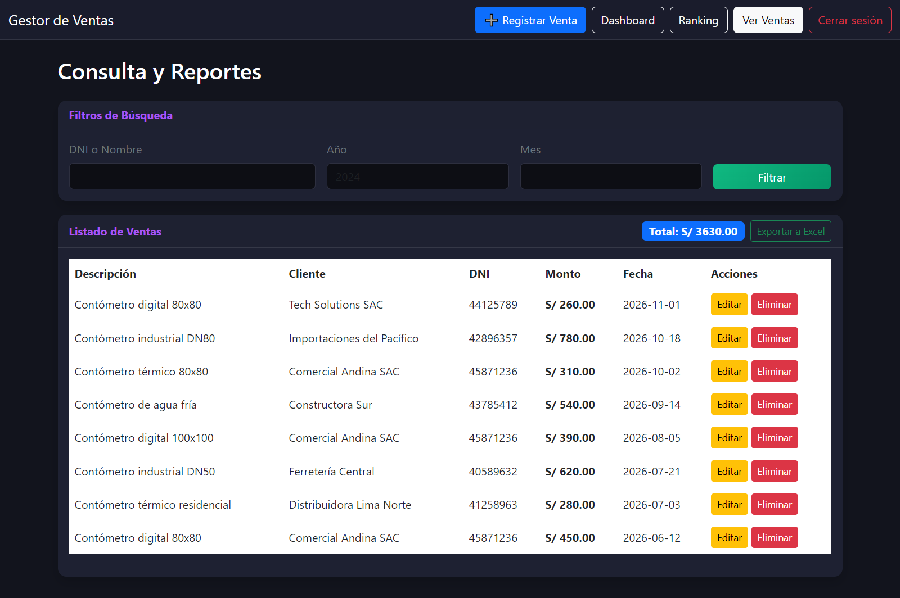
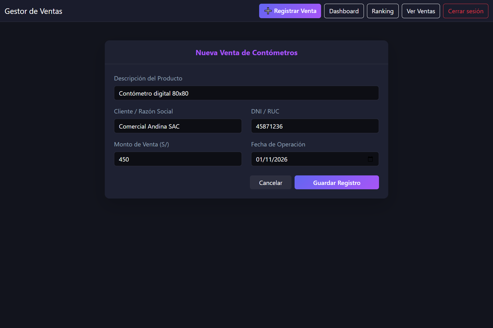
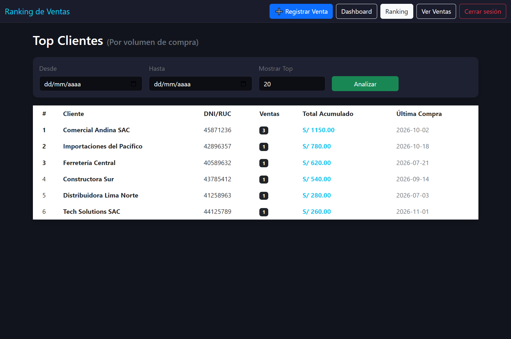

# Gestor de Ventas

Aplicación de escritorio para registrar, consultar y analizar las ventas de un pequeño negocio de contómetros. Funciona de forma local, sin servidor ni conexión a internet, y guarda la información en una base SQLite.


## Descripción

**Gestor de Ventas** es una aplicación de escritorio pensada para reemplazar el registro manual de ventas en planillas. Permite cargar cada operación, consultar el historial con filtros, ver estadísticas, identificar a los mejores clientes y exportar reportes a Excel.

El proyecto fue desarrollado con Electron, SQLite y JavaScript, y se empaqueta como instalador de Windows mediante `electron-builder`.

## Funcionalidades

- **Inicio de sesión local** con contraseña protegida mediante hash `scrypt`.
- **Registro de ventas** con descripción, cliente, DNI/RUC, monto y fecha.
- **Consulta y filtros** por nombre, DNI, año y mes.
- **Edición y eliminación** de ventas existentes.
- **Dashboard** con ganancia total, cantidad de registros y gráfico mensual histórico.
- **Ranking de clientes** por volumen de compra, con filtros por fecha.
- **Exportación a Excel** respetando los filtros aplicados, con hojas de ventas y resumen.
- **Copias de seguridad y restauración** de la base de datos, con validación del archivo y copia de seguridad automática antes de restaurar.
- **Cambio de contraseña** desde la propia aplicación.
- **Cierre de sesión** y protección de todas las pantallas internas.
- **Funcionamiento offline**: no requiere internet ni un servidor de base de datos.

## Capturas

> Las capturas usan datos ficticios de demostración.

| Login | Dashboard |
| --- | --- |
|  |  |

| Consulta de ventas | Registrar venta |
| --- | --- |
|  |  |

| Ranking de clientes |
| --- |
|  |

## Tecnologías

| Tecnología | Uso |
| --- | --- |
| Electron 28 | Aplicación de escritorio y comunicación entre procesos |
| Node.js | Proceso principal, lógica de negocio e IPC |
| SQLite 3 (`sqlite3`) | Persistencia local de ventas y usuarios |
| JavaScript (ES6+) | Lógica del renderer y del proceso principal |
| Bootstrap 5 | Interfaz y componentes visuales |
| Chart.js | Gráfico mensual del dashboard |
| ExcelJS | Generación de reportes `.xlsx` |
| electron-builder | Empaquetado e instalador NSIS para Windows |

## Requisitos

- **Windows 10 u 11** (64 bits).
- **Node.js 20.17 o superior** y **npm** para ejecutar el proyecto desde el código fuente.
- No se necesita instalar SQLite ni ningún servidor de base de datos.

## Instalación y ejecución

1. Cloná el repositorio o descargá el código como ZIP:

```bash
git clone https://github.com/Legus2077/registro-de-ventas.git
cd registro-de-ventas
```

2. Instalá las dependencias:

```bash
npm install
```

> La primera instalación puede tardar unos minutos porque descarga Electron y el módulo de SQLite.

3. Iniciá la aplicación:

```bash
npm start
```

También podés usar `npm ci` si querés instalar exactamente las versiones fijadas en `package-lock.json`.

## Primer ingreso

Al iniciar por primera vez, la aplicación crea la base de datos vacía y un usuario administrador:

| Campo | Valor |
| --- | --- |
| Usuario | `administrador` |
| Contraseña | `13579` |

> Cambiá la contraseña inicial desde **Dashboard → Seguridad** antes de usar la aplicación con datos reales.

## Compilar el instalador

```bash
npm run build
```

El instalador se genera dentro de la carpeta `dist/`. Al no estar firmado digitalmente, Windows puede mostrar una advertencia de SmartScreen la primera vez que se ejecuta.

## Restablecer la contraseña

Si se olvida la contraseña, cerrá la aplicación y ejecutá:

```bash
npm run reset-password -- administrador NuevaClave123
```

Si no se indica una contraseña nueva, el script genera una aleatoria y la muestra en la consola:

```bash
npm run reset-password
```

El script actualiza la contraseña directamente en la base de datos local. Es importante que la aplicación esté cerrada para evitar bloqueos del archivo.

## Dónde se guardan los datos

La base de datos se almacena en el perfil del usuario de Windows:

```text
%APPDATA%\registro-de-ventas\ventas_pro.db
```

Incluye las ventas y el usuario administrador. La aplicación permite crear copias de seguridad desde el Dashboard y restaurarlas más adelante. Antes de restaurar, se genera automáticamente una copia de seguridad de la base actual.

## Scripts disponibles

| Comando | Descripción |
| --- | --- |
| `npm start` | Ejecuta la aplicación en modo desarrollo |
| `npm run build` | Genera el instalador de Windows en `dist/` |
| `npm run reset-password` | Restablece la contraseña de un usuario local |

## Estructura del proyecto

```text
registro-de-ventas/
├── src/
│   ├── main/
│   │   ├── main.js              # Proceso principal, base de datos e IPC
│   │   ├── preload.js           # Puente seguro entre renderer y main
│   │   └── lib/
│   │       ├── backup.js        # Validación y copias de seguridad
│   │       ├── excel_export.js  # Generación de reportes Excel
│   │       └── passwords.js     # Hash y verificación de contraseñas
│   ├── renderer/
│   │   ├── pages/               # Pantallas HTML
│   │   ├── js/                  # Lógica de cada pantalla
│   │   └── vendor/              # Bootstrap y Chart.js locales
│   └── assets/
│       └── icon.ico
├── scripts/
│   └── reset-password.js        # Recuperación de acceso
├── docs/
│   └── screenshots/             # Capturas para la documentación
├── package.json
└── README.md
```

## Seguridad y alcance

- Las contraseñas se guardan con hash `scrypt` y sal aleatoria; nunca en texto plano.
- La base SQLite **no está cifrada**. Quien tenga acceso al archivo `.db` puede leer las ventas, por lo que se recomienda proteger la cuenta de Windows del equipo.
- La aplicación está diseñada para un único usuario local. No incluye roles, multiusuario ni sincronización en la nube.
- El instalador no está firmado digitalmente; es un proyecto personal/educativo publicado como parte de un portafolio.

## Autor

**Leonardo Condori**

Proyecto desarrollado como aplicación real para la gestión de ventas de contómetros y publicado con fines de portafolio.
